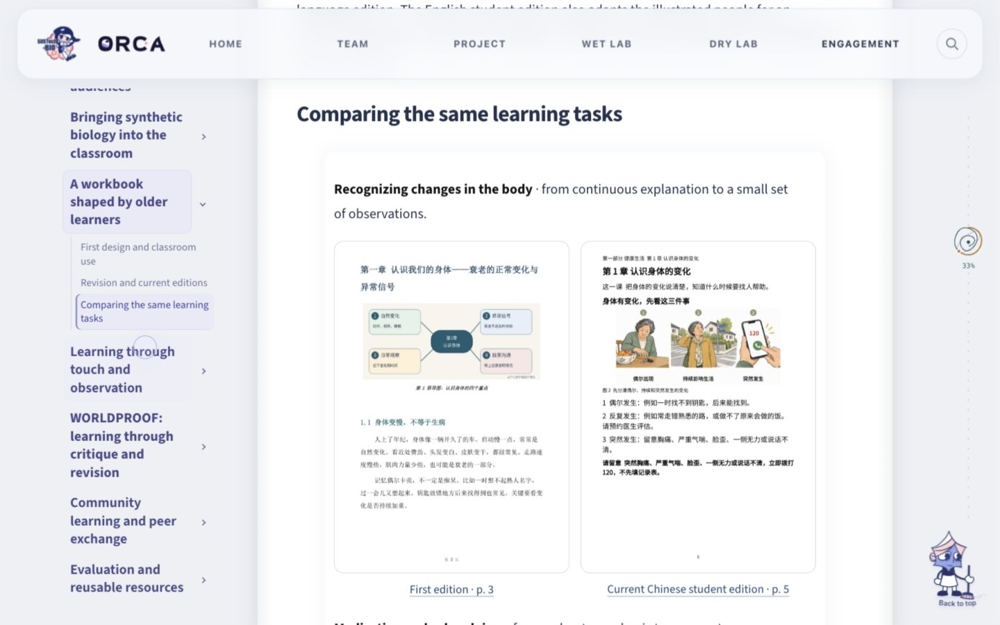
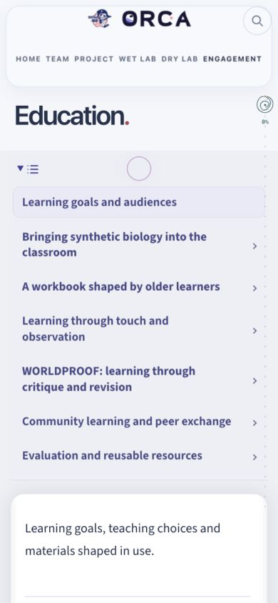

# Initial local handoff (historical)

The record below describes the initial restructuring pass. See `release.md` for the later English revisions, final title fonts and release checks.

# Education 七章重组交付记录

2026 年 10 月 21 日，本地源文件已接入 `/education`。当前工作区与分支保持原状，没有提交、推送、部署，没有生成或覆盖共享 `public/`。预览地址：<http://127.0.0.1:8417/education>。

## 范围与协作

开始时已读取 README、CLAUDE、协作记录和当前 Education，检查工作目录、Git 状态与 worktree。只有当前这一份 checkout，分支为 `design/one-take-home`；Education 主稿和模板本来就在其他窗口留下的未跟踪成果中，不能用 Git HEAD 代替本地最新版本。因此本次以实时文件为基线，并保存逐文件备份于 `.local-backups/education-restructure-20261021/`。

共享锁由首页任务 `home-neuron-rna-continuity-20261021` 持有，本次没有改共享集成文件，也未移除该锁。任务期间其 owner 文件增加了 `wiki/pages/home.html`，表明其他工作仍在进行。Education 使用自己的临时协作记录，结束时只释放自己的记录。HP、Inclusivity、全站布局及全站样式均未编辑；没有新增路由或页面。

## 新旧目录对照及内容迁移

| 本地修改前目录或内容 | 新目录落点 | 迁移方式 |
| --- | --- | --- |
| 页首开场、Learning together | 1. Learning goals and audiences | 改为受众、学习目标与场景差异；提供三个重点项目的直接入口。Learning together 旧锚点保留为别名。 |
| Starting in the classroom | 2. Bringing synthetic biology into the classroom | 独立一级章。保留课程迁移工具、课程框架、报告、覆盖图、两位教师访谈组件、原图弹窗和全文下载。 |
| A handbook shaped by readers | 3. A workbook shaped by older learners | 按初版、Shahe 课堂与使用、反馈、当前改版、评价整理。版本表、三份最新 PDF 阅读器及原有活动照片全部保留。 |
| Science you can touch；Everyday conversations 中的 Kindergarten | 4. Learning through touch and observation | 模型制作与完整幼儿园活动集中到一处；保留打印方署名、两份 STL、模型交互组件入口、教师完整反馈与图片。社区处仅保留索引。 |
| WORLDPROOF | 5. WORLDPROOF: learning through critique and revision | 独立一级章。学习任务和证据先行；评委组件、海报和合照作为辅助记录，原资源与署名保留。 |
| Everyday conversations、A shared garden | 6. Community learning and peer exchange → Community programmes | 保留青篮小学、桃源、校园、专业展、线上渠道和 ICII；Shahe、幼儿园只索引前文完整记录。 |
| Exchanges with other teams | 第六章 → Peer learning and community contribution | 原十站路线保留；活动降为四级标题，图片按活动折叠。Grand APiC 保留共同组织职责、合作方、演讲与规模，但把规模与教育成效分开。 |
| Resources and records | 7. Evaluation and reusable resources | 综合既有反馈、后续评价计划、资源版本与使用条件。旧 `education-records` 保留。 |
| A consent game · planned | 第七章 → Further development | 保持概念状态，课堂、手册与 TacTune 后续评价也在这里索引。 |
| Thank you | 第七章 → Acknowledgements | 压缩为两段，保留原有合作方、机构、评委、活动支持者及团队贡献。结束合照仍可展开。 |

## 三个重点案例新增的实质内容

**课程合作：**明确四种配置各自的贡献团队、六个维度、0–3 记录方式以及课程与考试的分列。以报告第 2、5 页的分子基础／DBTL 覆盖差异解释教学选择。把 Li 的蛋白工程与胰岛素案例、Wang 的 Grade 11 和 12–15 课时建议，同课时、实践机会、已有知识联系起来。新增“依据—学习任务—将来可保留作品”表，明确它是现阶段教学设计的回顾性综合，不宣称课程已经实施。已完成材料、设计阶段和待实施评价分别陈述。

**老年手册：**保留最新 56 页中文学生版、56 页英文学生版和 54 页中文教师版，不退回旧的 42／37 页草稿。加入两组从实际 PDF 渲染的同主题页面对照：初版 p.3 与当前中文学生版 p.5；初版 p.20 与当前版 p.10。图注明确指出文字层级、编号步骤、插图、提醒、练习的变化，并指出笔记空间在 pp.47–50。保留字号／密度、书写、查找、印刷条件的反馈链；区分 Ms. Wu 的建议和团队新增的主题、表格、语言版及师生分册。新增三个与当前 PDF 来源一致的可编辑 DOCX 下载，不更改原始文件。

**WORLDPROOF：**把 Build／Break／Fix 任务、预期记录与教学目的放在人物介绍前。直接使用挑战包中的 Riverlight，具体说明角色、可选产物和三类 reality check。明确这是已有挑战任务，不能替代真实参与者作品案例。新增挑战包的建议使用流程，同时保留“情景库尚非完整教案／评分表”的实际使用范围。撤下“每队都完成一轮并记录修改”的无充分材料支持的绝对表述，保留 Zhang 的回忆性体验反馈并按其证据范围解释。

## 图注、组件与资源处理

- Li Jiaju 采访截图在本次开始前已经去重。本次没有重复修改教师组件、图片或合并图注；清晰裁切、原图入口与 Figure 2 保留。
- 保留全部旧图像和链接 URL。根据新的阅读顺序统一 Figure 1–44；教师组件中的 Figure 2 无需修改。`figure-map.json` 记录旧图号与新图号，历史 `hp-figure-*` ID 保持不变。
- 原先只有别名的 `hp-figure-22` 用于同主题版本对照，不删除任何原始图片。
- 修正幼儿园反馈嵌套 HTML 导致后半页脱离正文容器的问题。教师完整引语改为无框正文，保留 attribution 和 `hp-voice-teachers` 锚点。
- 新增 Education 专属小脚本，让折叠活动记录中的历史锚点在定位前自动展开；复用现有滚动定位组件。
- 现有共享 PDF 增强脚本会隐藏一些原始下载入口。本次只在 Education 局部恢复带版本标签的下载链接，未编辑共享脚本。
- 保留既有模型、课程工具、PDF、访谈、交流路线、ICII 和评委组件；未新造无数据互动。

## 仍缺少的原始材料

| 项目 | 下一步需要的原始记录 | 当前页面采用的范围 |
| --- | --- | --- |
| 高中课程 | 完整课程／逐课教案、实际授课日期与班级、任务作品、课堂时间记录、教师实施后意见、评价方案与结果。 | 已有文档分析、访谈、工具和教学任务设计方向；没有写成已授课或已提高学生能力。 |
| 老年手册 | 可追溯的匿名化 Shahe 现场笔记／逐条反馈原件、课堂日期及人数、初版自测作答记录、最新版再次试用记录、阅读／查找／书写反馈、印刷打样和成本比较。 | 以当前本地叙事所记录的课堂与反馈说明形成性改版；新材料尚未有复试效果数据。 |
| WORLDPROOF | 参与者原型或作品、修改前后版本、评审原问题、现场记录、任务完成情况、活动正式时序、评价表和获授权的作品发布信息。 | 展示真实挑战包和活动产物，不虚构完整案例或能力提升。 |
| 实体模型与 TacTune | 可复现的引导语／操作步骤、学习者反应与作品、音频和相机原型同目标学习者的使用测试。 | 区分实体活动和软件原型；不声称已验证视障教学效果。 |
| 社区及交流 | 具体学习者回应、作品、同期观察原件；Grand APiC 各方职责及组织材料可进一步细化。 | 保留原日期、合作方、工作内容和链接；不把合照、奖项、规模当学习效果。 |
| 资源复用 | 模型、挑战包及第三方插图／贡献的独立授权说明如有应补入。 | 保留现有 credits 和 notices，没有承诺所有资源可任意使用。 |

## 验证结果

- `tests.test_wiki` 与 `tests.test_igem_assets`：37 项通过。
- 首轮连同 `tests.test_content` 共 42 项：41 通过，1 项失败。失败来自 **未修改的 HP 主稿 `subtitle: ""`** 与现有 `test_every_configured_markdown_file_parses` 的非空检查；没有为使检查变绿而改动 HP 或共享测试。
- Education 专项审计：7 个主章；91 个既有内容锚点保留，另补 `education` 入口；181 个去重的页面资源／链接入口核查，原有 URL 无丢失、本地资源或站内 fragment 无失败、无重复静态 ID。结果见 `audit.json`。
- 图注检查：新顺序 Figure 1–44 连续；保留教师组件 Figure 2；full-size 链接说明与相应图号一致。下载 DOCX 与实际来源逐字节相同，ZIP 结构完整。
- Education HTML 元素嵌套检查通过；专属 JavaScript 语法检查通过；本次范围的 diff 空白检查通过。
- 浏览器：1440×900 桌面、390×844 手机及默认侧栏宽度实看。七章目录、桌面子目录、手机展开／选中后收起、旧 `hp-figure-29` 自动展开、手册对照图片和无横向页面溢出已验证。
- 浏览器：三份当前手册分别读出 56／56／54 页且生成 canvas；放大后的页宽由 290 变为 362.5，再缩小成功。教师访谈主题切换可显示胰岛素案例，搜索 electrophoresis 返回 3 个 Q&A。
- 三个 DOCX 和本地下载入口的 HTTP 访问与文件完整性检查通过。**浏览器的下载回执等待超时，因此不宣称已获得浏览器保存成功回执。**
- 首选浏览器连接因本地原生依赖签名错误不可用，随后使用已有的应用内浏览器完成上述检查。临时手机尺寸已恢复。
- 未对所有外部活动报道、外站和录播重新做在线可用性／全文审计；保留其原入口。当前手册远程 PDF 已由阅读器实际加载；其已上传校验记录保留在原 manifest。

## 实际改动文件

页面源文件：

- `docs/human-practices/education.md`
- `wiki/pages/education.html`，仅增加专属 CSS 和 JS 两条引用。

Education 专属文件：

- `static/human-practices/education/chapters.css`
- `static/human-practices/education/chapters.js`
- `static/human-practices/education/workbook-v1-body-p3.png`
- `static/human-practices/education/workbook-current-body-p5.png`
- `static/human-practices/education/workbook-v1-medicine-p20.png`
- `static/human-practices/education/workbook-current-medicine-p10.png`
- `assets/human-practices/education/workbook-current-student-zh.docx`
- `assets/human-practices/education/workbook-current-student-en.docx`
- `assets/human-practices/education/workbook-current-teacher-zh.docx`

交付核查文件均位于 `docs/qa/education-restructure-20261021/`：本记录、`audit.py`、`audit.json`、`figure-map.json`、`provenance.json`、`task-files.json` 和四张代表性截图。未改其他窗口的源文件。

这些内容已经接入本地正式 Education 路由，并非另一个网页原型。新增对照图和 DOCX 只在本地源文件和本地预览中可用，尚未上传到 CDN 或发布；本次按要求不执行上传或部署。

## 代表性截图

桌面手册版本对照：

手机七章目录：

另存 `worldproof-desktop.png` 与 `workbook-comparison-mobile.png`，可对照桌面重点章节和手机单列页面。
